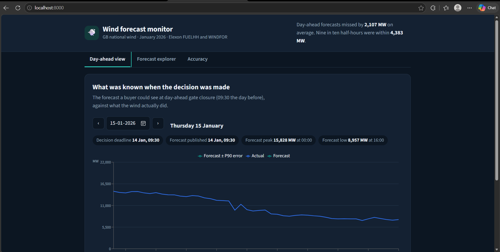
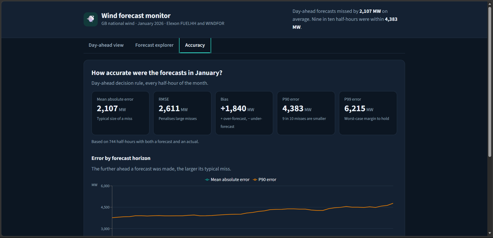
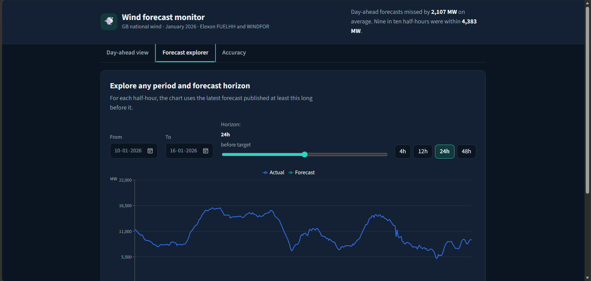

# Wind Forecast Monitor

A dashboard for analysing Great Britain's wind power forecasts against actual generation. It is built around a day-ahead power buying use case and answers two questions: what forecast was available before the decision deadline, and how accurate was it?

The app uses Elexon's WINDFOR forecasts and FUELHH generation data for January 2026.

| | |
|---|---|
| **Live app** | [wind-forecast-analytics-gray.vercel.app](https://wind-forecast-analytics-gray.vercel.app/) |
| **Video walkthrough** | _add unlisted YouTube link_ |
| **Design write-up** | [docs/architecture.md](docs/architecture.md) |

## Screenshots







## What it does

- **Overview:** Summarises forecast performance across January using MAE, RMSE, bias, and the 90th and 99th percentiles of absolute error.
- **Day-ahead view:** Select a delivery date and compare actual generation with the latest forecast published before the configured 09:30 London-time cutoff on the previous day.
- **Horizon explorer:** Choose a date range and forecast horizon to see how forecasts compare with actual generation at different lead times.
- **Error by horizon:** Compare MAE and P90 absolute error across horizons from 0 to 48 hours.

The charts show forecast and actual generation together, making it easier to spot periods when the forecast missed the shape or level of wind output. The selected view, date and horizon are kept in the URL, so a particular analysis can be shared as a link.

## How it works

The data is downloaded with `scripts/fetch_data.py` and saved as JSON files. The backend loads and indexes the data to find the relevant forecast for each half-hourly delivery period.

For a delivery time and a given cutoff, the app selects the forecast with the latest publication time that is **at or before the cutoff**. This prevents the analysis from using forecasts published after the decision time.

The backend uses FastAPI. The frontend is built with React, Vite and Recharts. The deployed app is a single Vercel project: the built frontend is served as static files and the FastAPI app runs as a Python serverless function under `/api`. Docker packages the same two parts into one container.

## Method and assumptions

- **Actual generation:** Elexon FUELHH, filtered to `fuelType=WIND`.
- **Forecasts:** Elexon WINDFOR.
- **Period:** January 2026.
- **Day-ahead cutoff:** 09:30 Europe/London on the day before delivery. This is a configurable assumption, not a verified representation of every relevant market deadline.
- **Horizon analysis:** For each target time, the cutoff is the target time minus the selected horizon.
- **Error:** `forecast - actual`. Positive bias means the forecast was higher than actual generation on average.
- **Metrics:** MAE is the average absolute error, RMSE gives greater weight to larger misses, bias shows the direction of the average error, and P90/P99 describe the upper tail of absolute errors.

This is a forecast-performance analysis, not a complete power procurement or trading model. It does not include electricity prices, demand forecasts, or the financial cost of forecast errors.

## Project structure

```
.
├── api/
│   └── index.py              Vercel entrypoint, re-exports the FastAPI app
├── backend/
│   ├── app/
│   │   ├── analysis.py       forecast selection, gate closure, error metrics
│   │   ├── data.py           loads and indexes the JSON datasets
│   │   └── main.py           FastAPI routes; serves frontend/dist when present
│   ├── data/
│   │   ├── actuals.json      FUELHH wind actuals, January 2026
│   │   └── forecasts.json    WINDFOR forecasts with publish times
│   └── tests/
│       └── test_analysis.py  unit tests for the analysis logic
├── frontend/
│   ├── public/               static assets (web manifest, precomputed accuracy.json)
│   ├── index.html
│   ├── vite.config.js        dev server proxies /api to the backend
│   └── src/
│       ├── App.jsx, main.jsx
│       ├── components/
│       │   ├── charts/       SeriesChart, ErrorHorizonChart
│       │   ├── controls/     DateRangePicker, HorizonControl, TabNavigation
│       │   ├── layout/       DashboardLayout, Header, Sidebar, StatusBar
│       │   ├── metrics/      MetricGrid, MetricCard
│       │   ├── states/       Skeleton, EmptyState, ErrorBanner
│       │   ├── tabs/         Overview, DayAhead, HorizonExplorer, ErrorHorizon
│       │   └── ui/           ThemeToggle, ShortcutsModal
│       ├── context/          app state (with URL sync) and theme
│       ├── hooks/            useApi, useChartSync, useKeyboardShortcuts, useLocalStorage
│       ├── styles/           design tokens, layout and component CSS
│       └── utils/            formatters (London time, numbers), chart colours
├── scripts/
│   ├── fetch_data.py         downloads actuals and forecasts from the Elexon API
│   └── precompute_accuracy.py  precomputes the accuracy summary
├── docs/
│   ├── architecture.md       design and implementation walkthrough
│   └── screenshots/          images used in this README
├── extras/
│   └── video-script.md       script for the demo video
├── Dockerfile                builds the frontend, serves everything from FastAPI
├── vercel.json               Vercel build and routing configuration
├── requirements.txt          runtime Python dependencies
└── requirements-dev.txt      adds the fetch script and test dependencies
```

## API

| Endpoint | Parameters | Returns |
|---|---|---|
| `GET /api/series` | `start`, `end`, `horizon` (0 to 48) | actual vs forecast series and metrics |
| `GET /api/day-ahead` | `day` | series at gate closure for that delivery day, with metrics |
| `GET /api/accuracy` | none | January day-ahead metrics and error by horizon |

## Running locally

### 1. Refresh the data (optional)

This requires internet access. The committed JSON files can be used as they are.

```bash
pip install -r requirements-dev.txt
python scripts/fetch_data.py
```

### 2. Run with Docker

```bash
docker build -t wind-monitor .
docker run -p 8000:8000 wind-monitor
```

Open [http://localhost:8000](http://localhost:8000).

### 3. Run for development

Start the backend from the project root:

```bash
uvicorn backend.app.main:app --reload
```

Start the frontend in another terminal:

```bash
cd frontend
npm install
npm run dev
```

Open [http://localhost:5173](http://localhost:5173). Run the backend tests from the project root with `pytest`.

## Deployment

The live app runs on Vercel as one project. `vercel.json` builds the frontend into static files and routes `/api/*` to `api/index.py`, which exposes the FastAPI app as a Python function. The JSON data files are bundled with that function, so no database or external service is needed at runtime.

To redeploy, push to `main`; Vercel builds from the repository root.

## Testing

The backend tests cover forecast cutoff selection, including forecasts published exactly at the cutoff, forecasts published after it, missing earlier forecasts, gate-closure calculation, and metric calculations.

Frontend and end-to-end test coverage is limited to manual checks of the deployed app.

## Limitations and next steps

- The 09:30 day-ahead cutoff is an assumption and should be checked against the intended procurement decision process.
- The analysis covers January 2026 and the two specified Elexon datasets.
- There is no demand or price data, so forecast errors are measured in MW rather than monetary exposure.
- Data refresh is manual rather than scheduled.
- Frontend and end-to-end test coverage can be expanded.

Potential next steps include scheduled data ingestion, adding demand and price data, estimating the financial exposure of forecast errors, and alerting users when a new forecast materially changes expected generation.

## Use of AI tools

I used **Claude Code and OpenCode** during development to work more efficiently on the project. They helped with initial scaffolding, exploring implementation approaches, writing and refactoring code, and preparing documentation.

Using these tools reduced time spent on repetitive setup and helped me iterate on the implementation more quickly. I reviewed the generated changes, focused on understanding the forecast-selection and metric calculations, and used tests and application checks to validate the parts I could verify.

AI tools assisted the development process, but the project still required engineering decisions around data handling, forecast cutoffs, error metrics, deployment, and the limitations of the analysis.