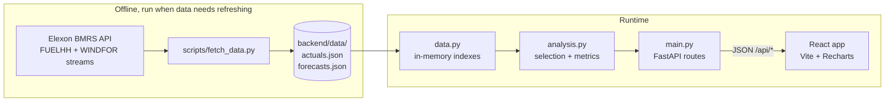

# Architecture

## 1. Purpose and scope

The app answers two questions for a day-ahead power buying desk:

1. What is the latest wind forecast that was available when the buying decision had to be made?
2. How accurate were such forecasts, quantitatively, so the error can be priced into the decision?

Scope is fixed by the brief: national GB wind only, Elexon `FUELHH` (actuals, `fuelType = WIND`) and `WINDFOR` (forecasts), purchase decisions for January 2026.

## 2. System overview



Two decisions shape everything else:

- **Data is pre-fetched, not queried live.** The scope is one fixed month, so the two datasets are downloaded once into JSON files that ship with the code. The API then has no external dependency, no cold-start download, no rate-limit exposure and deterministic results. This is what makes a serverless deploy practical.
- **One piece of logic serves every view.** Every chart and metric is "for each target half-hour, pick the latest forecast published at or before some cutoff, then compare with the actual". Views differ only in how the cutoff is computed.

## 3. Data model

### Actuals (`actuals.json`)

```json
{ "startTime": "2026-01-01T00:00:00Z", "generation": 8123 }
```

Loaded into `ACTUALS: dict[datetime, MW]`. If Elexon republished a settlement period, the fetch script keeps the latest publication, so there is exactly one value per half-hour.

### Forecasts (`forecasts.json`)

```json
{ "startTime": "2026-01-01T12:00:00Z", "publishTime": "2025-12-31T09:00:00Z", "generation": 7650 }
```

Loaded into `FORECASTS: dict[target, list[(publishTime, MW)]]`, each list sorted by `publishTime`. A target time therefore holds every forecast ever issued for it (up to roughly 48 hours of vintages), which is what allows "what did we know at time T" queries. Only fields that are used are stored.

Forecasts are downloaded from 48 hours before 1 January so that targets early in the month still have their full history. Rows are filtered to targets inside January.

## 4. Core algorithm (`backend/app/analysis.py`)

### Forecast selection

```
latest_run(runs, cutoff) -> the run with the greatest publishTime <= cutoff, or None
```

`runs` is sorted, so this is a binary search (`bisect_right` with a key), O(log k) per target where k is the number of vintages. The comparison is inclusive: a forecast published exactly at the cutoff counts as available. If nothing was published yet, the result is `None` and the chart shows a gap rather than a fabricated value.

### Cutoff rules

| View | Cutoff for target *t* |
|---|---|
| Day-ahead | `gate_closure(t)`: 09:30 Europe/London on the calendar day before *t*'s London date |
| Horizon explorer | `t − horizon` hours (0 to 48) |
| Error vs horizon | the same horizon rule, evaluated for every h in 0..48 |

All three go through `build_series(actuals, forecasts, start, end, cutoff_of)`, which walks the range in 30-minute steps and returns rows of `time`, `actual`, `forecast`, `publishTime`. The cutoff is passed in as a function, which is the single point of variation between views.

The 09:30 gate closure is an assumption held in one constant (`GATE_CLOSURE`). Timezone handling uses `zoneinfo`, so the rule remains correct across DST even though January stays on GMT.

### Metrics

`metrics(rows)` pairs rows where both forecast and actual exist, with error = forecast − actual:

| Metric | Meaning for the buyer |
|---|---|
| MAE | typical size of a miss |
| RMSE | like MAE but weights large misses more |
| Bias | systematic direction. Positive = wind over-forecast, so too little thermal was bought and the gap is settled at imbalance prices |
| P90 / P99 of absolute error | a margin to hold: "90% of the time the miss was below X MW" |
| n | number of half-hours behind the numbers |

Mean-style metrics describe the average; the percentile metrics describe the tail, which is what matters for risk. Both are reported because a good MAE can hide dangerous tail misses.

### Complexity

`accuracy_by_horizon` runs `build_series` 49 times over 1,488 half-hours, about 73k binary searches plus sorting for percentiles. This takes well under a second, and the result is cached with `functools.cache` because the data never changes during a process lifetime.

## 5. API (`backend/app/main.py`)

All times are ISO 8601. Requests with timezone-naive datetimes are rejected by validation (`AwareDatetime`).

| Endpoint | Parameters | Returns |
|---|---|---|
| `GET /api/series` | `start`, `end` (aware, within January 2026 UTC, start < end), `horizon` 0 to 48 (default 4) | `{ series, metrics }` |
| `GET /api/day-ahead` | `day` (date, London calendar day in January) | `{ gateClosure, series, metrics }` |
| `GET /api/accuracy` | none | `{ dayAhead: metrics, byHorizon: [{horizon, mae, rmse, bias, p90, p99, n}] }` |

Invalid ranges return HTTP 422 with a message. Routes contain only validation and orchestration; no selection or statistics logic lives in them.

If `frontend/dist` exists (the Docker case), the built frontend is mounted at `/` after the API routes, so one process serves both.

## 6. Frontend (`frontend/src`)

```
App.jsx                  page layout, state, tab components
context/
  ThemeContext.jsx       light/dark/system theme with localStorage persistence
  AppStateContext.jsx    global UI state (tab, day, range, horizon) with URL sync
hooks/
  useApi.js              fetch with 5min cache, abort controller, refetch
  useKeyboardShortcuts.js  keyboard navigation (1-4 tabs, arrows, ? help)
  useChartSync.js        crosshair synchronization across charts
  useLocalStorage.js     typed localStorage persistence
components/
  charts/
    SeriesChart.jsx      enhanced line chart: zoom/pan, crosshair sync, error bands, annotations
    ErrorHorizonChart.jsx  dual-axis area+line chart with horizon zone legend
  layout/
    DashboardLayout.jsx  sidebar + main content wrapper
    Header.jsx           title, theme selector, sidebar toggle, shortcuts
    Sidebar.jsx          collapsible nav with tab pills, quick stats, data scope
    StatusBar.jsx        data freshness, view indicator, version
  metrics/
    MetricGrid.jsx       responsive card grid with animated count-up values
    MetricCard.jsx       single metric card (animated + static versions)
  controls/
    DateRangePicker.jsx  from/to inputs + preset dropdown (Today, Week, Month)
    HorizonControl.jsx   slider + numeric input + presets + zone markers
    TabNavigation.jsx    pill tabs (mobile scrollable)
  states/
    Skeleton.jsx         shimmer placeholders for charts, metrics, tables
    EmptyState.jsx       illustrated empty states with contextual actions
    ErrorBanner.jsx      inline errors with retry + collapsible details
  ui/
    ThemeToggle.jsx      3-mode theme switcher
    ShortcutsModal.jsx   keyboard shortcuts reference
utils/
  formatters.js          London timezone, number, error formatting
  colors.js              semantic chart colors, horizon zones
styles/
  tokens.css             design tokens (colors, spacing, typography, shadows)
  layout.css             dashboard, sidebar, header, statusbar
  components.css         all component styles, animations, a11y helpers
  themes.css             (placeholder for future theme extensions)
```

- **State management**: Global UI state in `AppStateContext` (active tab, day, range, horizon, sidebar) persisted to localStorage and synced to URL for shareable links. Theme state in `ThemeContext`.
- **Data fetching**: `useApi` with 5-minute in-memory cache, abort controller for race condition prevention, automatic refetch on path change.
- **Charts**: `SeriesChart` used for actual-vs-forecast (Day-Ahead, Horizon Explorer) with zoom/pan via Recharts Brush, crosshair synchronization across charts via `useChartSync`, error bands (P90 envelope), gate closure annotations, missing data markers. `ErrorHorizonChart` shows MAE area + P90 line with horizon zone legend (Intraday ≤6h, Day-ahead 24–36h, Forward 36–48h).
- **Accessibility**: WCAG 2.1 AA — semantic HTML, ARIA labels, focus management, color contrast ≥4.5:1, reduced motion support, keyboard navigation, screen reader summaries for charts.
- **Responsive**: Breakpoints at 1200px (full sidebar), 900px (collapsed sidebar), 600px (sidebar → bottom sheet, tabs scrollable), <600px (stacked tabs, single-column metrics).
- **Animations**: Metric card count-up (ease-out cubic, 800ms), staggered entrance (50ms delay), fade-in for badges/descriptions. All disabled via `prefers-reduced-motion`.
- **Timestamps**: Travel as UTC ISO 8601, formatted in `Europe/London` in browser.
- **Missing values**: Stay `null` — lines break, tooltips show "—", missing data markers (✕) on chart.

Page structure: Tabbed dashboard — Overview (accuracy summary + error vs horizon), Day-Ahead (single day at gate closure), Horizon Explorer (range + horizon), Error vs Horizon (full 0–48h analysis).

## 7. Deployment

| Target | How |
|---|---|
| Docker | Multi-stage build: Node stage runs `vite build`; Python stage installs `requirements.txt`, copies `backend/` and the built `dist/`, runs `uvicorn` on `$PORT` |
| Vercel | `vercel.json` builds the frontend into `frontend/dist` (static), rewrites `/api/*` to the `api/index.py` Python function, and bundles `backend/data/**` into that function with `includeFiles` |
| Local dev | Vite dev server on 5173 proxies `/api` to uvicorn on 8000 |

The same FastAPI `app` object is used by uvicorn and by Vercel, so there is no separate serverless code path to maintain. The data files are small enough to load on every cold start.

## 8. Testing

`backend/tests/test_analysis.py` covers the logic that decides correctness:

- a forecast published after the cutoff is never used
- a forecast published exactly at the cutoff is used
- no forecast before the first publication yields `None`
- gate closure is 09:30 on the previous day
- `build_series` applies the horizon and leaves gaps as `None`
- metric values, and `None` when there are no pairs

The analysis functions take the data as arguments instead of importing globals, so tests use small hand-built inputs and need no data files. API and frontend tests are not included.

## 9. Design decisions and trade-offs

| Decision | Why | Cost |
|---|---|---|
| Pre-fetched JSON instead of live Elexon calls | Reliable demo, fast, works on serverless, reproducible numbers | Data must be refreshed manually; not suitable beyond a fixed period |
| In-memory dict plus bisect instead of a database or pandas | Data is tiny and read-only; keeps the Vercel bundle small and code short | Would not scale to years of data or multiple datasets |
| Cutoff passed as a function | One code path for all views | Slightly more abstract than three separate loops |
| Percentiles alongside MAE/RMSE | Buyers manage tail risk | More numbers to explain on screen |
| Single-process serving in Docker | One container, no CORS, simple ops | Static files and API scale together |

## 10. Known limitations and next steps

- Gate closure is assumed to be 09:30; confirm with the client which auction they trade in.
- Accuracy is measured against settled FUELHH output at national level only; no regional, demand or price data, so the app cannot yet convert MW error into £ exposure.
- The Elexon download script has not been run in the build environment; verify its date-window handling on first use.
- Possible next steps: show the P90 band around the forecast, convert error to cost with price data, alert when a new forecast revises the previous one sharply, and replace the JSON files with a scheduled ingestion job.